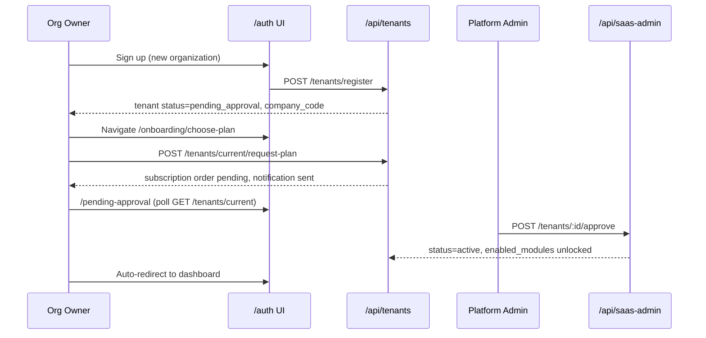
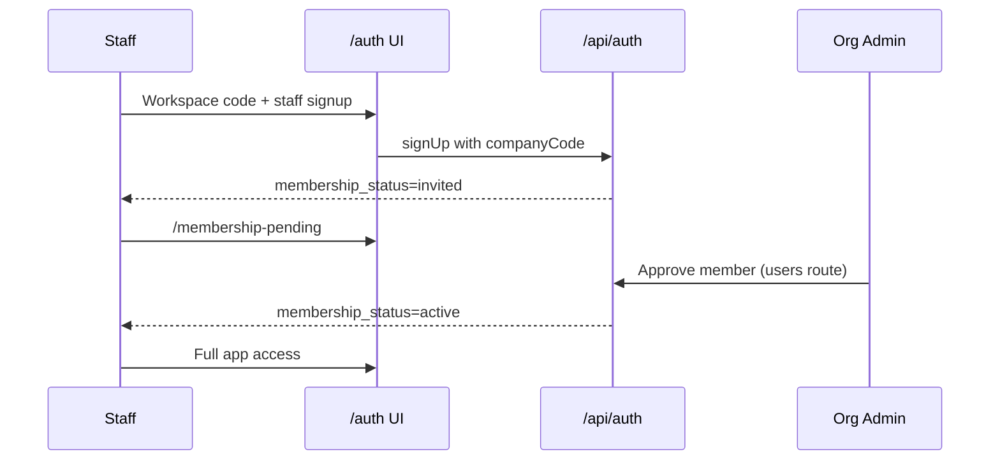

# SaaS approval & package flows — sequence reference

## Organization registration → package → platform approval



## Staff join existing pharmacy



## Package creation (platform admin)

1. `GET /api/saas-admin/plans` — list plans
2. `POST /api/saas-admin/plans` — create `{ code, name, max_users, max_locations, price_monthly }`
3. `PATCH /api/saas-admin/plans/:code` — edit limits/pricing
4. `DELETE /api/saas-admin/plans/:code` — deactivate (soft) or delete if unused

## Package assignment to tenant

**During onboarding (tenant owner):**
- `POST /api/tenants/current/request-plan` — creates pending `tenant_subscription_orders` row

**By platform admin:**
- `POST /api/saas-admin/tenants/:id/allocate-plan` — sets `plan_code`, `plan_valid_until`, creates paid/pending order

## Tenant status lifecycle

| Status | Meaning |
|--------|---------|
| `pending_approval` | Self-signup, awaiting platform review |
| `active` | Full module access |
| `suspended` | Login blocked / read-only |
| `cancelled` | Subscription ended |
| `offboarding` | Export window |
| `deleted` | Anonymized |

## Frontend guards (order matters)

```
AuthProvider
  └─ TenantProvider
       └─ StaffMembershipGuard      → /membership-pending if invited
            └─ CustomerPortalGuard   → customer portal pending
                 └─ TenantApprovedGuard → /pending-approval if org not active
                      └─ MotherAccountGuard → billing pages owner-only
```

## UI animation triggers

| Screen | Animation |
|--------|-----------|
| `/auth` | Toggle `is-active` on container → 0.6s slide between login/signup |
| Choose plan | Plan cards: staggered fade-in, hover lift -6px, ring on select |
| Approve button | `btn-slide-shine` hover shine sweep |
| Pending page | Clock icon `animate-pulse`, 15s polling refetch |
